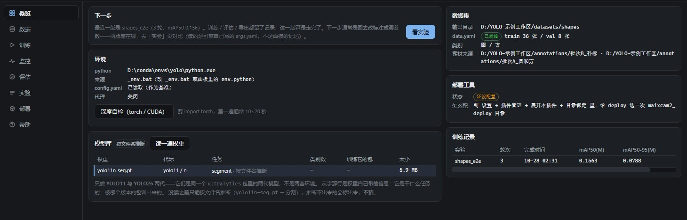

# YOLO 训练工作台 / YOLO Training Workbench

一个 **Uartix+ 代码插件（v3）**：把 YOLO 的「数据集拆分 → 训练 → 部署收口」三件事装进一个面板，
参数在面板里改，`python` 子进程由插件自己起，日志与进度实时拉回界面。

> 下面这张是**真面板的渲染**（数据来自一次真跑出来的实验），底色与控件跟随 Uartix+ 主题。

## 它是什么

- **一个面板**（`contributes.panels`）：环境自检、配置三层叠加、数据集扫描、训练实时进度与日志、训练记录（含每轮完成时间）、部署收口。
- **两条命令**（`contributes.commands`）：`yolo.status`（看现状）、`yolo.stop`（停止当前任务），
  在命令面板和 AI 里都能直接调，与面板按钮走同一批函数。
- 配置遵循**三层**：内置默认 ← 工作区 `config.yaml` 基准 ← 面板改动（只存与基准不同的那部分）。
- **训练参数面不是抄来的**：面板那张表由当前那套 `ultralytics` 自己吐出来（`DEFAULT_CFG_DICT`，本机 111 键），
  包里没这个键就不出现。所以包升级、键改名（`half` 已经没了）都会自动跟上，不会出现"面板能填、引擎不认"。
- **每次实验落一份完整快照** `train_runs/<实验名>-<时间>.yaml`。它是面板与命令行的公共语言：
  拿它去跑你自己的 `python scripts/train.py --config …` 照样成立（那条只认它自己那 20 个键）。
- **不重新实现你的流水线**：工作区的 `config.yaml`、`scripts/*.py`、`00~07*.bat` 一个字节都不改；
  新参数走插件自带的 `runner/train_job.py`（跟 `model.train(**overrides)` 直接透传），不动你的脚本。
- **标注不归它管**：`annotations/` 只是一个投料口目录——你把 X-AnyLabeling 导出的文件夹丢进去，
  面板只数有多少图、多少 json，点一下登记成素材来源，不搬、不改、不删你的东西。

## 装它

在 Uartix+ 里：**设置 → 插件管理 → 插件市场**，搜 `uartix.yolo`（话题 `topic:uartix-plugin`），点安装。
装进来是**停用态**；在插件管理里逐条看过并**批准权限**之后才能启用，批准卡会列出它要读写的目录与要起的程序。

也可以从本地目录装：把整个仓库目录放进 `<AppData>/plugins/` 之外任选一处，在插件管理里「从目录安装」。

## 用之前要做的一件事：登记路径

- **工作区根（`$WS`）**：在 **设置 → 插件管理 → 展开「YOLO 训练工作台」→ 目录绑定 → 工作区根** 里选择你的项目根目录。
  数据集、runs、logs、models，以及本插件生成的 `.uartix/` 状态目录都落在它下面（**写牢笼**只放行这几枚子目录）。
- **部署工具目录（`$EXT:deploy`）**：只有用到「部署」那一段才需要——在同一处「目录绑定」里给它选一个绝对路径。
  没绑时部署相关读数会照实显示「未绑定」，训练/数据集那几段不受影响（读缺绑定是降级，不是拒绝）。

## 权限（都在批准卡上逐条给你看）

| 类别 | 声明 | 实际约束 |
| --- | --- | --- |
| 读 | `$WS`、`$EXT:deploy` | 读是**知情**：Node 的精确读白名单在 Windows 上不生效，故读整盘放行、清单只告诉你它读了什么 |
| 写 | `$WS/.uartix` `$WS/annotations` `$WS/datasets` `$WS/logs` `$WS/models` `$WS/runs` `$WS/train_runs` | 写是**牢笼**：内核级 `--allow-fs-write` 只放行这几枚目录，越界直接 `ERR_ACCESS_DENIED`。注意没有"工作区根"这一条——**你那份 `config.yaml`、`scripts/*.py`、`00~07*.bat` 面板从早到尾都写不到** |
| 进程 | `python` | 起子进程跑 ultralytics；停止走杀进程树（Windows 上只杀 node 会留孤儿吃满 GPU） |
| 界面 | `ui.panel` | 一块 iframe 面板（不透明源，碰不到宿主 DOM 与别的插件；宿主主题以 `--uartix-*` 变量桥入，换主题时面板热更新） |

## 依赖

本插件**自带** `main.mjs` + `panel.html` + `runner/train_job.py`，不下载任何东西；但要真正跑训练，需要目标机器上有：

- Python + [`ultralytics`](https://github.com/ultralytics/ultralytics)（面板里那颗「深度自检」会报 torch/CUDA/ultralytics 版本；YOLO26 需要 ≥ 8.4）；
- 一个 YOLO 数据集（`images/` + `labels/` 结构，面板能扫描并按比例拆分）。

## 关于「桌宠 / 无边框」

没有单独的“桌宠”概念。透明无边框只是小部件（`contributes.widgets`）的一种表现形态；本插件不涉及小部件，只贡献面板与命令。

## 许可

MIT。见 [LICENSE](LICENSE)。

## 版本

`0.7.4` — **P178-D：没有 Python 时它自己说，有 conda 时它不抢**：面板顶上多了一条引导——没有可用 Python 时直接给「一键安装运行环境」和「装 CPU 版」，写明装在 `.uartix/yolo/envs/`、不动你已有的 conda，不用点了训练才看到报错。环境卡多一个**「用回工作区 Python」**：点了之后插件环境**仍然在**（不被删），只是不被选中，随时能「启用它」——这是给「我本来就有 conda」的人留的退路，之前的实现里把 selected 清空会退回到「第一份 ready」，等于关不掉。帮助抽屉新增「运行环境（Python / torch）」一节：装在哪、优先级（`env.python` > 插件环境 > `_env.bat` > 系统）、版本怎么钉的、镜像顺序、断了怎么续、怎么拆；权限那节也改成现在的 10 个域名 + 三个可执行。市场封面换成这一版的真实渲染（路径已打码），图上就是「插件环境在，但用的是你自己的 `_env.bat`」。
`0.7.3` — **清理入口补到位**：「上次没装完」那个状态下也给了「清理全部…」——之前只有装成功后才摸得到清理，而最想清掉的恰恰是装坏的那半份。
`0.7.2` — **P178-C：装得住，也拆得干净**：你有 conda 的话，插件环境只是"另一份"，**不会动你原来的**——这一版把这句话变成了代码里的硬约束：① **uv 的五处落点全部改道**（`UV_CACHE_DIR` / `UV_PYTHON_INSTALL_DIR` / `UV_PYTHON_BIN_DIR` / `UV_TOOL_DIR` / `UV_TOOL_BIN_DIR` 都指到 `$WS/.uartix/yolo/envs/` 下面），否则 uv 会往 `%APPDATA%\uv`、`%LOCALAPPDATA%\uv` 里留第二份缓存和托管 Python——那正是"清不干净"的来源。② **「清理全部…」**：环境目录 + uv + 缓存 + 工具目录**整体移入回收站**（不是逐个删，逐个删最容易漏掉几 GB 的 `envs/cache`），两步确认，清完把默认环境指向也一并收回；你工作区的 `models/`、`datasets/`、`scripts/` 一个字节都不动，判据里就用这两份"诱饵"盯着。③ **体检**（`envDoctor`）：选中的环境文件还在不在、三个包能不能 import、Python 版本多少——不对劲就直说"解释器不见了"，不偷偷重装。④ 清完仍可恢复：所有删除都走 `rename` 进 `.uartix/yolo/trash/`。这一版权限面没变，不需要重新批准。
`0.7.1` — **P178-B：安装器能装、能断、能续**：上一版把"一键安装"跑通了，但它只有一条直路——断网、按取消、两个窗口同时点，都会留下说不清的半成品。这一版补齐：① **续装**——退出前按磁盘上的事实判断（venv 在不在、`import torch/torchvision/ultralytics` 能不能过），已经装好的步骤直接跳过，不会为了一次断线重下 4 GB；面板上给「继续安装（跳过已装好的部分）」，`env.json` 里留着第一次创建时间，续装不是"又装了一份新的"。② **锁**——同一时刻只允许一份安装（`envs/.install.lock` 带 pid + 6 小时硬上限），第二个窗口会被告知"另一个面板正在装（进程 xxx）"；确认它真的没了可以点「清理锁」，活着的锁不给清。被锁挡住时**一个字节都不写**（以前会顺手留下一个假的 broken 环境）。③ **状态写得清**——`env.json` 多了 `phase`（死在哪一步）和 `logTail`（最后 20 行），失败时不用重跑一次才能复现。④ **依赖检查**——装完跑 `uv pip check`，冲突只记录不拦（ultralytics 的 opencv/numpy 拉扯很常见，不该让人白装一次）。⑤ **失败也放锁**——以前异常路径会把锁留在盘上，用户从此装不了第二次，而提示只会说"另一个面板在装"。⑥ 顺手修掉两个会直接毁掉"装成功"的 bug：`code` 变量在成功路径上遮蔽了外层退出码（走到最后一行必抛 `Assignment to constant variable`，装好了也判成 broken）、续装时先写 `env.json` 再读，把"上次死在哪一步"和原始创建时间一起冲掉。这一版**权限面没变**（还是那 10 个域名与 `python`/`uv`/`powershell`），不需要重新批准。
`0.7.0` — **P178-A：运行环境自举（别的新用户装了也能跑）**：以前这台机器能训练是因为作者自己装了 Python + torch + ultralytics，别人下载插件只会看到 `python ?`。现在插件能在面板里**自己把环境装起来**：`$WS/.uartix/yolo/envs/<id>/` 下一个独立 venv，装完直接拿它训练/导出/评估，不碰系统 Python、不装进 PATH、不需要管理员。默认给 **GPU 版**（torch 2.12.0 + cu126，驱动 580.88 以上给 cu130），也给你一个 **CPU 版**按钮——显卡太老（Pascal/Volta）或无 N 卡时自动选 cu126/CPU。版本全部钉死并走过镜像校验：CPython 3.12.16、torch 2.12.0、torchvision 0.27.0、ultralytics 8.4.128（装不上按 8.4.121 → 8.4.102 退）。**先中科大、再南大、最后 GitHub**，uv 本体也走同样的顺序；PyTorch 轮子固定从阿里云 `-f` 拿（清华 PyPI 的 torch 是 CPU-only，这点写进了设计文档）。装的时候逐行报进度（下载/解压/建 venv/装 torch/装 ultralytics/自检），可取消、可续传、失败只重试当前源。配置里开着代理会**先探活再用**——代理没起来（Clash 关了/换了端口）就直连，不把 uv 指向死端口。下载断流有完整性校验：半截的 `uv.zip` 不会被改名成正式文件（否则只会看到"压缩包损坏"），留 `.part` 下次从断点续。装完做一次 `import torch; torch.cuda.is_available()` 自检并把结论写进 `env.json`；之后解释器优先级是 **配置里写死的 `env.python` > 插件装的 env > `_env.bat` > 系统 Python**，所以不会抢你手写的路径。磁盘先查再装（不够直接说差多少 GB）。**权限面变了**：`process.spawn` 加了 `uv` 与 `powershell`（解压 uv 包用），`net.connect` 增到 10 个域名（uv/python 安装源、清华/阿里/南大/中科大 PyPI 镜像、download.pytorch.org），更新后批准卡会多出这几行。「环境」页暂时只放了这一张卡，完整向导（选位置/代理/镜像健康检查/多环境管理）等宿主 1 MiB 读取上限的版本发出来再做。
`0.6.0` — **P177-E：续训、磁盘守卫与收尾**：实验页的 `⋯` 菜单多了「继续训练…」——默认**从 `last.pt` 开一个新 run**（`<原名>-resume`），优化器状态保住、原 run 的产物不动、曲线从第 1 轮重新计；确认框里会先把权重/新实验名/总轮次列清楚，并提醒 `epochs` 是总轮次不是增量。Ultralytics 原生 `resume` 收进「高级选项」，会写回原 run 目录，风险写在按钮旁边。开跑前加了**磁盘守卫**：按最近同类 run 的实测体积 × 1.5 预估，空间不够就当场说清楚而不是跑一半盘满。回收站默认**不自动清空**；保留策略（30 天）只写在帮助里，不偷偷执行。资产页补上表格行多选（勾几行 → 预演回收）、回收站保留策略（默认「不自动清理」，设 30/90 天后也只由你点「清理过期」才执行）；标注体检补「完全重复的图」和「投料口来源账」两项；部署校验补 `$Labels` 类别数比对（与权重 nc、数据集类别表对不上会拦/警告）。帮助抽屉同步更新了资产/清理、联网权限与续训三段。
`0.5.3` — **P177-D：部署标准化**：部署页顶部只留**一个目标画像**（MaixCAM2 · Pulsar2 4.0 · 640×480 · opset 11 · 检测/分割），两份 `deploy_config*.ps1` 降级为「外部底座（只读）」，都带「旧」标签和差异说明（模型指向旧 best.pt、模型名太泛、校准指向旧数据集），不再并列成两个配方。开跑前先跑一遍校验：模型任务/类别、校准图数量（≥60）与是否来自当前训练集、输入尺寸 32 倍数、opset、Docker/WSL；校准来源与训练集不一致时必须勾选确认才放行，WSL 坏了直接说清而不是让 `deploy.ps1` 干等。打包成功后自动**登记部署包**：只在外部 `deploy/out/work/logs` 里按名字找 `.mud` / 两个 `axmodel` / `demo` / `meta.json` / 最近转换日志，复制到 `train_runs/deploy/<bundle>/` 并写 `deployment.json`（SHA256、模型/run/数据集/校准指纹、外部路径），**不复制 386M 的 work/73M 的 calib，也不删外部任何文件**。资产页与部署页都能看到已登记的包。
`0.5.2` — **P177-C：官方权重下载**：模型库右上角多一个「下载官方权重」——只列 YOLO11 / YOLO26 的检测与分割（共 20 枚），来源固定在 `ultralytics/assets` 的 `v8.4.0` release，先在弹窗里说明 **AGPL-3.0** 并要你勾一下才会开始。下载走插件自带的 `runner/download_job.py`：HTTPS + 主机白名单、`.part` 续传、进度行、可取消、失败重试两次、单文件上限 200MB、下完算 SHA256 并记账到 `models/pretrained/downloads.json`，落 `models/pretrained/<family>/`。下完**不会**自动设成训练权重，也不会替你装包。这一次权限面新增 `net.connect`（github.com / objects.githubusercontent.com / raw.githubusercontent.com），**更新后需要重新批准一次**，批准卡上会多三行「联网 …」。
`0.5.1` — **P177-B：清理、引用与回收站**：资产页从只读台账变成能干活——顶部清理建议（重复权重按 SHA 合并、轮次远少于配置的短 run、非 run 目录、legacy extras、孤儿评估/导出），每条带原因、体积和引用，**默认一条都不勾**；勾选后先「预演」，列出会动的路径与体积，被引用阻止的会说明是谁在引用，并可「连同引用一起再预演」。删除一律 `rename` 进 `.uartix/yolo/trash/<stamp>/<kind>/<id>/`，恢复回原路径（原路径被占时明说），永久删除与清空都要输入确认词，全部写 `.uartix/yolo/audit.jsonl`。回收站与审计在资产页可见；外部部署缓存只统计体积并给一份「复制清理清单」，插件不删。原始 `annotations/`、用户脚本、`$EXT:deploy` 不在任何清理路径上。
`0.5.0` — **P177-A：资产台账与 run 状态**：新增第 7 个「资产」工作面（只读台账：数据集 / 训练产物 / 模型 / 部署包 / 回收站 / 存储），数据集带快速指纹与 run 血缘；run 状态持久化到 `train_runs/runs/<run>.json`（running / succeeded / stopped / failed / interrupted / external / incomplete），重启后不再把“结束/崩溃/手动跑”混在一起，手动 run 不冒充中断；路径输入框记住最近使用（`.uartix/yolo/prefs.json`，每字段 12 条，标存在/缺失）；归档改到 `train_runs/archive/`（修掉原来写 `archive/` 却不在写权限里的 bug）；交付命名修掉 `[object Object]`，同 SHA 重复交付只留一份。清理、回收站恢复、官方权重下载、部署包登记在后续批次。
`0.4.5` — **P176-B6：部署四步与收尾**：部署页顶部四步时间线（环境 → 导出 → 编译 → 打包），每步显示就绪 / 进行中 / 完成 / 失败，可单独执行；环境步骤接 Docker/WSL 检测。配方列表改成全宽表格（配方 / 模型名 / 尺寸 / 镜像 / 校准），点行选中，窄屏不再挤成横向滚动。帮助抽屉加搜索与「部署与 Docker」分节；部署页长说明压到 120 字内，细节进抽屉。a11y：页签与结果分段带 aria 状态、图例 aria-pressed、焦点可见、减少动效。
`0.4.4` — **P176-B5：实验表与对比**：实验页改成可排序表（完成时间 / 轮次 / 最佳轮 / mAP50-95(B) / mAP50-95(M) / 用时 / 状态），行操作收进 `⋯` 弹层（看曲线 / 评估 / 等价命令 / 归档 / 备注）。对比卡从「结果 → 指标」移到实验页：两个 run 的曲线叠加（A 实线 / B 虚线）、指标 A→B 与差值、参数差异只列不同的项。
`0.4.3` — **P176-B4：图表 v2**：结果页的两张手绘折线换成 `lineChart`——Y 轴刻度、X 轴轮次、图例点击显隐、悬停十字线与逐条数值、平滑（原值 / 0.6 / 0.9，只影响画线，tooltip 读原始值）、最佳轮标记与竖线、数字表 fallback。新增学习率曲线与本次会话的显存曲线；单点与空数据不崩。监控/对比的抽稀从 140 行提到 400 行，最佳轮标记不再因抽稀偏一轮。
`0.4.2` — **P176-B3：结果页合成四段**：结果页现在是共用头部（run 选择 + 状态 + 刷新 + 自动刷新）+ 5 枚 KPI（轮次、best mask mAP50-95、当前 loss、显存、剩余）+ 四个视图「曲线 / 指标 / 错例 / 失败」。指标页新增逐类条形图（框/掩膜双条 + 最弱类提示）。顺带修掉评估 runner 的两个真 bug：分割评估的掩膜指标读错属性（`.mask` → `.seg`），以前只报框指标；阈值表读 `Metric.curves`（恒空）导致永远为空——现在改读 `curves_results`，并输出 `perClass`。旧评估结果会提示「重跑一次评估才有逐类数据」，不会假装有。
`0.4.1` — **P176-B2：参数悬停说明**：训练页 52 个参数都带 `?` 与自定义浮层（悬停 300ms / 聚焦 / 长按 500ms；Esc 关闭；点 `?` 钉住）。内容来自插件里的 `PARAM_HELP`：一句话、默认值、范围、影响、可点的相关参数——不是原生 title。`fliplr` / `flipud` 这类数字/文字警告改成常驻橙色提示，不再藏起来。滚动时浮层跟着锚点走，不会凭空消失。
`0.4.0` — **P176-B1：六工作面 + 帮助抽屉 + 概览 KPI**：8 个页签收成 6 块（概览 / 数据 / 训练 / 结果 / 实验 / 部署），监控与评估合成「结果」的实时曲线 / 评估结果两个视图；帮助从左侧导航移到右上角 `?` 抽屉（配置、模型、参数、快照、数据、体检、增强、曲线、权限九节）。概览新增工作区 / 数据 / 环境状态条与四枚 KPI（训练图、验证图、类别、最近 best mask mAP50-95）。主界面说明压到 120 字以内，长解释统一进抽屉，卡片里留「为什么?」直达对应分节；训练页的核心六项改成 3×2 网格。权限面没变，不需要重新批准。
`0.3.7` — **部署日志不再乱码**：PowerShell 5.1 的 stdout 默认跟系统代码页（这台是 GBK），日志却按 UTF-8 收——`deploy.ps1` 打的每一句中文都成了 `➜➜VdC┌`。现在启动时先把 `[Console]::OutputEncoding` 设成 UTF-8 再调脚本；插件生成的包装配置也补上 UTF-8 BOM（没有 BOM 时 PowerShell 5.1 会按 GBK 解析，中文模型名/路径会被读坏）。顺带把同一个任务终态被刷两行的问题按 job id 去重。
`0.3.6` — **部署页先问 Docker，再解释那几块是干什么的**：
① 「配置与执行」上方新增 Docker 检测（进页面自动测一次，也可手动重测）。引擎没起时不再只说"不可用"，而是分清两层：Docker 自己没开，还是 **WSL 连系统虚拟机都创建不出来**（`HCS/ERROR_NOT_FOUND`）——后一种和插件权限、目录绑定、管理员身份都无关，面板直接给出管理员 PowerShell 里该跑的两条命令。
② 点「开始部署 / 只编译」时先做同样的预检：WSL 真坏了就直接说明，不再让 `deploy.ps1` 干等 180 秒——那就是"一直转圈"的来源。
③ 三块卡片各加一句人话：**导出**只产出 ONNX 等中间格式（上板文件不在这里）、**模型**是交付区副本（不是第二个模型列表）、配置列表里的每份 `deploy_config*.ps1` 是一套转换配方（面板只覆盖模型与校准图，不改原文件）。
`0.3.5` — **把"启动失败"翻译成人话，并修掉体检崩**：
① 改了工作区绑定 / 更新过插件之后，跑起来的进程还拿着旧的写权限，一按构建就是 Node 那句 "Access to this API has been restricted"。现在插件启动时探一次七个写目录，写不了的在面板顶上直接列出来，并告诉你"重启一次应用才生效"；任务启动失败也翻成同样的话。
② 数据集还没构建时点「体检」会崩在 `null.concat`（`images/train` 不存在时列表是 null）。现在不崩，并且会明确报「数据集目录不存在，先去构建」。
③ 失败归类多一条：`ModuleNotFoundError` →「这套 python 里没有 ultralytics」（多半是 _env.bat 指错了解释器）。
`0.3.4` — **候选只扫一份，四个页面共用**：权重 / 数据集 / 设备 / 校准图现在由一个 `picks()` 统一扫出来——训练页的权重、数据集、设备三个输入框带上了下拉候选（也可以自己敲路径，官方权重名也在里面），部署页可以**选任意一次训练的 best.pt、交付区的、模型库的，或手填任何盘上的 .pt**；校准图也能选（自动跟当前数据集 / 跟配置文件 / 指定某个数据集）。顺手修掉两处写死：`latestBest` 以前只认 `runs/`（配置里 project 换了就找不到训练产物），部署的 `-Step` 现在先做白名单校验。
`0.3.3` — **增强预览能看清了**：数据页右栏加宽（1 : 1.45），train_batch 拼图占满整栏；**点图弹到整屏**（点哪儿 / Esc 关闭）。另外把最容易误会的一件事写在图下面：**框上标的是类别 id（0 起），不是类别名**——你的数据 0=1、1=2、2=3，看着就像整体标错了一位，其实是引擎画图时用的 id。现在图例直接给出「0 = 1 · 1 = 2 · 2 = 3」的对照。
`0.3.2` — **整个工作台换壳**：横向页签改成**左侧竖栏导航**（图标 + 名称，窄窗口自动只留图标）；每个页签从一列往下堆改成**双栏**——概览、数据、训练、监控、评估、部署各自分成主栏与侧栏，宽屏并排、窄屏自动落回单列；**日志从底部占 34% 的大窗改成可收起的抽屉**，收起来只有一行：最后一条日志 + 出错时红点计数，点一下才展开。这几处合起来把每个过程都是一条竖直长卷这件事解决掉了。
`0.3.1` — **训练页重排**：52 项不再平铺成一张大表。现在分三层——「练什么」（任务 / 权重 / 数据集）、「练多久、练多细」（轮次、分辨率、批大小、设备、早停、实验名六个常改的）、**「高级参数」**（优化器 9 / 增强 19 / 微调 3 / 性能与复现 9 / 时长与输出 4，默认全部折叠，标题上直接写「改了 N 项」，一眼看得出有没有动过）；「开始训练 / 停止 / 先看参数 / 保存」做成顶部常驻工具栏，滚到哪儿都在手边，右边跟着「3 轮 · 640 · batch 8 · device 0」这行摘要。**权限面没变**，所以这次更新不需要再过批准卡。

`0.3.0`（W1，P175 第一批）— **参数面换成引擎自己给的**：训练页从 8 项涨到按五组摆开的 40+ 项（基础 / 优化器 / 增强 / 微调 / 性能与复现），每项都带引擎的真实默认值，包里没这个键就不出现；探测失败自动降级成最小集并明说。**新增参数真的会生效**：训练改由插件自带的 `runner/train_job.py` 执行（把 `train:` 段透传给 `model.train(**overrides)`，不认识的键点名丢掉），你那套 `scripts/train.py` 与 `00~07*.bat` 一个字没动。每次开跑在 `train_runs/` 落一份完整 yaml 快照，日志里同时给出「手动等价命令」。新增「先看这次会用什么参数」——让 `ultralytics` 自己的配置校验把这次要送进去的参数认一遍。数据页新增标注投料口 `annotations/`（只数不写；素材夹留空时「构建数据集」直接从这个目录取）。权限多两枚写目录（`train_runs` / `annotations`），因此**要重新过一次批准卡**。

同批（W2）还加了：**模型库**（列 `models/**.pt` + 官方可下载名，读得出每枚权重自带的 task / 类别数 / 训练它的包版本；读不出时老实标"按文件名推断"或"读不出"）、**任务只有检测与分割**（拿 detect 权重跑 segment 会在开跑前被拦下并解释，且不留下快照）、**任务自动识别**（按标签每行 token 数给建议 + 置信度 + 依据，**要点「按建议设置」才落配置**；混合标注会警告 detect 会静默丢弃 segments；4 点多边形与 OBB 分不开时只报出来不替你决定）、**续训只认 `last.pt`**（填 `best.pt` 或 `true` 直接拒并说明原因）。

同批（W3）加了数据页的**标注体检**（只读：越界坐标、空标签、找不到图的标签、类别分布与 `nc/names` 对不对得上、**train 与 val 重名 = 数据泄漏**、类别缺失、类别悬殊）与**增强预览**（给的是引擎自己写出的 `train_batch*.jpg`，不是面板画的假图；预览只认训练产物目录里那个文件名）。

同批（W4）加了**监控页**：损失与 mAP 曲线直接读引擎写的 `runs/<实验>/results.csv`（(B) 框、(M) 掩膜分列，列不存在就少画一条线，不编），ETA 用**实测平均**（累计耗时 ÷ 已完成轮数）而不是引擎打的那个数，显存走 `nvidia-smi`（比 import torch 快两个数量级，才轮询得起），日志新增「只看错误」过滤；任务失败会自动**归类**（显存不够 / 标注不合法 / 路径缺失 / 版本参数不匹配 / CUDA 不可用 / 网络代理 / 你停的），每条都给下一步做什么。

同批（W5）加了**评估页**：选权重 + 数据集跑一次 `val`，指标表按 task 出 `(B)/(M)`，引擎画的混淆矩阵 / PR / F1 图能直接看；**阈值对照表读的是同一次 val 的 PR 曲线**（不重复跑 N 遍验证集）；勾选后另跑一遍 predict 出**错例清单**（含每张图的预测框数与类别，拿去补标）；还有**与另一个 run 对比**——读两份 `args.yaml` 列出参数差异，两条曲线并排。评估结果只落 `train_runs/eval/`，不碰你的 `runs/` 与 `scripts/validate_viz.py`。

**修掉一个已上线的行为 bug**：面板桥只转发 `(method, args)` 一个载荷，而部署那颗按钮用三个位置参数调 `deployStart` —— 结果「只检查环境」「只编译」「只打包」三个按钮实际都在跑**全流程**。现在插件方法一律收单个对象参数，并加了两条判据钉住（面板里不许出现三参数的 `uartix.call`，插件侧注册的每个方法只许一个形参）。

同批（W6）把部署页的**导出**重做了：格式矩阵（onnx / openvino / engine / torchscript / coreml / saved_model / pb / edgetpu / paddle / mnn / ncnn / imx / rknn / executorch / axelera / deepx / qnn / litert / hailo，`tflite` 是别名不单列）、`imgsz / dynamic / simplify / opset / quantize / nms`（**没有 `half`**，它在 8.4 已被 `quantize` 取代）、导出后显示**体积 + 拿导出文件真跑一遍测出的 ms/图**，以及**端侧约束卡**——MaixCam / MaixHub 在线转换器只吃目标检测（opset=17、dynamic=False），所以分割模型"导出成功"也上不了板，这一点在点之前就说。产物落 `train_runs/export/`，你的 `scripts/export_onnx.py` 与 `05_export_onnx.bat` 不动。

同批（W7）加了**实验页**：列表读每个 run 的 `args.yaml` + `results.csv`（面板不另存一份实验记录，所以不会出现"面板说训过、盘上找不到"），可写备注（落在 `train_runs/<实验>.note`，不碰 `runs/`）、可两两对比（参数差异 + 曲线并排）、**等价命令**三条可复制可存成 `.bat`（只落 `train_runs/bat/`，编号脚本不动），以及归档——**只复制不搬走**：`train_runs/archive/<实验>-<时间>/` 里放 `args.yaml + results.csv + best.pt`，`runs/` 里的原件留在原地。

同批（W8）加了面板内**帮助**页（三层配置、面板与手动同源、只读清单、只做 11/26、任务识别只是建议、`half` 为什么没了、续训为什么只认 `last.pt`、为什么这次要重新批准），并补了三条防回退的判据：每块页签都必须有 section 且切换时被显式处理（防"点了什么都不显示"）、包里每个文件都发得出去（防静默跳过 runner）、包内文件数不超过发布上限。

收官又修了四件事：**任务结束后面板不再停在"运行中"**（子进程的输出刚好在两个日志批之间被冲完时，终态事件会被空的日志批吞掉——现在终态自己无条件发一次）；监控页「自动刷新」那颗勾选框不再把说明挤到下一行（根因是全局 `label` 竖排 + `input{width:100%}`，已补常驻判据盯住这一形状）；恒为 0 的曲线（如分割 run 里的 `sem_loss`）不进图，但会在图例后写明省略了谁；评估页读盘上的 `eval.json` 时缺字段显示 `—` 而不是 `undefined`。

**拿一个真数据集从头到尾跑了一遍之后**（44 张图 / 两类 / 3 轮训练 → 评估 → 导出），又照出六件只在真跑时才会露面的事，全修了：

- **中文类别名会被读成乱码**。读 `config.yaml` 走的是"让工作区的 python 解析"这条正路，而 python 在 Windows 上按控制台代码页写输出、面板按 UTF-8 读 —— `classes: ['圆','方']` 变成两个不像字的字符，然后**不报错地**写进快照。表现是「构建数据集」成功退出、标注框 0 个。现在所有 python 调用都强制 UTF-8，并有一条判据拿真 python 钉住"中文类别名原样回到面板上"。
- **面板不会替你的环境装包**。导出后测速那一步，`ultralytics` 发现缺 `onnxruntime-gpu` 就自己去 `pip install`（还带 `--break-system-packages`）。装东西是你的决定，不是它的默认 —— 现在所有 python 子进程都带 `YOLO_AUTOINSTALL=false`，缺什么就明确失败并说清楚。
- **概览的「训练记录」曾是一张空表**：面板里有两个同名函数，实验页那份把概览这份静默盖掉了（语法合法、不报错，只有真数据能照出来）。补了一条常驻判据：插件里不许出现同名函数。
- **「等价命令」以前写的是裸 `python`**，而这台机器的解释器是 conda 环境里的绝对路径 —— 复制到 cmd 里根本跑不通。现在用探测到的那枚 python。
- **构建成功但一个标注框都没有**，现在会明说：读脚本自己打的账（每类多少框、跳过多少），有问题就在任务卡与日志里给一句"提醒"，而不是只报"完成"。
- **指标全是 0 的时候，话说对了**：以前写"这次没拿到 PR 曲线"，其实真相是"这个权重在这条阈值下什么都没检出"—— 前者会让人怀疑评估坏了，后者告诉你该调阈值还是该回去训。
- **你按的「停止」不再被报成故障**：以前进度卡会写"进程退出码 null（往上翻日志看 [错误]）"，日志里再念一条"失败归类：你停掉的"。现在停止有自己的一种终态，措辞是"已停止（你按的停止，不是出错）"。

界面上还加了一处：**概览顶部的「下一步」**。单人本地训练是按周回来一次的活，隔一周人就不记得走到哪了；现在面板按盘上的真实状态说一句话——没素材就说往 `annotations/` 放，有素材就说去构建，训完了就说去评估——并给一颗跳到那一页的按钮。

`0.2.4` — 面板改由宿主主题驱动：删掉自带的深色配色，改读宿主桥进来的 `--uartix-*` 设计 token（另有 `--bg` / `--fg` / `--accent` 等短别名），输入框、按钮、卡片、滚动条与宿主同套底色、描边、圆角与焦点环；换主题时面板热更新，不再需要重开。

`0.2.3` — 训练记录新增「完成时间」（取 `results.csv` 的最后写入时刻，悬停可看完整时间与用时）；修正部署页在部分主题下丢失描边与底色；窄窗口下的页头与表格改为可换行/横向滚动；目录绑定说明改到「设置 → 插件管理」。
